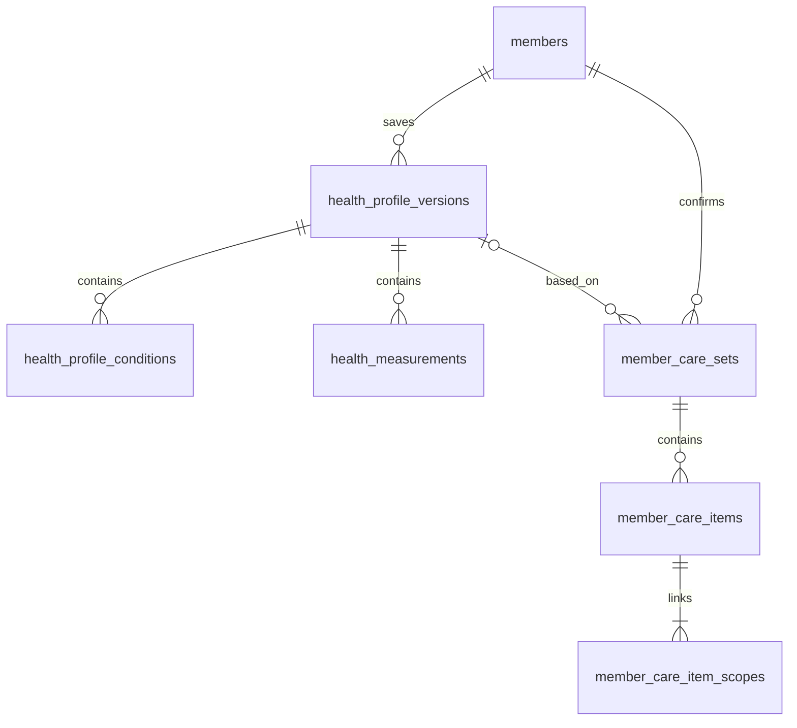

# SmartNF 건강정보 저장·MyPage 연동 설계 검토

> 후속 구현본 작성(2026-10-28): 아래 내용은 사전 제안 기록이다. 실제 구현은 HEALTH_STORAGE_SETUP.md와 개선문서102절을 따른다. 기존 9개 테이블 구성을 유지하되 previous_* 자기참조 대신 회원별 잠금과 id 정렬로 버전을 관리하고, 중복 검증용 body_hash와 동의 이벤트 ID를 추가했다. Java21 전체 빌드·실제 MySQL/화면 동작은 사용자 확인 대기다.

- 작성일: 2026-10-28
- 상태: 기존 코드 검토 완료 / 구현 전 변경 범위와 물리 모델 제안
- 이번 전달: 문서만 변경. Java·HTML·JS·SQL·실행 스크립트·실행 중 DB는 변경하지 않음.
- 기준: 전달한 최신 인증 소스(구글 UserInfo 수정 포함)와 사용자의 로컬 정상 보고. 사용자 PC의 추가 수정과 실제 DB 내용은 직접 읽지 못함.

## 1. 확인된 결정·완료·미완료

| 구분 | 확인 내용 |
|---|---|
| 기존 결정 | SmartNF 단일 프로젝트에서 공통 회원 사용. 향후 헬스케어와 필요한 인증·DB·기록용 MyPage를 함께 추출 |
| 인증 완료 보고 | 일반·카카오·네이버·구글 가입/로그인/로그아웃/재로그인 정상. 구글 수정 후 BUILD SUCCESSFUL 사용자 보고 |
| 저장 상태 | 건강정보 확정은 smartnf.health-profile.v1, 관리항목 확정은 smartnf.food-guide-context.v1. 같은 탭 sessionStorage·24시간이며 계정 DB 저장 아님 |
| MyPage | /preview/mypage 및 하위 화면은 공개 가상 화면. 실제 회원별 조회·수정·동의 저장 없음 |
| DB 구현 | 소스에 회원 V1, 카카오 V2, 네이버 V3, 구글 V4가 있음. 건강정보 마이그레이션·Repository·Controller 없음 |
| 기존 ERD | 회원 물리 모델과 건강정보 개념 관계만 존재. 건강 입력 전체 컬럼·관리항목 이력·실제 API는 후속 설계 필요 |
| 확인되지 않음 | 사용자 DB의 현재 V2~V4 조회 결과·MySQL 정확한 버전·운영 동의/보관 정책·배포/모바일 검증 |

정상 보고는 로컬 사용자 검증이며 공개 운영 승인이나 모든 테스트 환경 통과라는 의미가 아니다.

## 2. 코드 대조에서 발견한 개선 항목

1. health-profile.js의 허용 종류(kinds)에 month가 없어 diagnosed_0~4가 확정·복원 대상에서 빠진다. 회원 저장 이전에 월 단위 입력의 검증/포착/복원을 함께 수정해야 한다. 기존 임시 확정본에 없던 진단월을 복구할 수는 없다.
2. 건강 화면은 age·현재 체중·조건별 측정값을 사용하지만 MyPage 시연은 birthday·다른 활동 수준·목표 필드명을 사용한다. 생년월일을 새 필수 정보로 추가하지 않고 건강정보 입력을 기준으로 통일한다.
3. 알레르기는 별도 smartnf.allergy-profile.v1 계약이다. 일반 건강정보 확정에서 의도적으로 제외된다. 이번 1차 계정 저장에 몰래 포함하지 않으며, 계정에서 복원되는 항목과 별도 임시 조건임을 명확히 안내한다.
4. 관리항목은 하나의 행동이 여러 분야와 연결된다. 분야별 일부 해제와 전체 행동 해제를 구분해야 한다. 단순 action ID 배열로 저장하면 현재 기능을 잃는다.
5. 임시 관리항목은 입력 변경/선택 해제 시 기존 전달을 지우고, 빈 목록 자체는 확정하지 못한다. DB에는 이전 선택 전체를 비우는 명시적 확정도 지원해야 한다.
6. health-guide.js는 현재 화면의 가상 예시 선택 상태로 demo를 판별한다. 화면 예시와 본인 입력/서버 기록이 섞이지 않도록 계정 저장 시 입력 출처를 별도로 검증해야 한다. 클라이언트 demo=false 자체는 진실성 증명이 아니다.
7. 회원 ERD의 최초 작성 시점 상태와 이후 구현 현황이 함께 남아 혼동 가능성이 있다. 최신 상태 안내를 상단에 추가한다.

## 3. 이번 구현 범위 제안

1차는 로그인 회원이 직접 확인한 건강정보·확정 관리항목을 저장하고 MyPage에서 최신본·저장 이력을 조회하는 기능이다. 입력 수정은 동일 건강정보 화면에서 새 버전을 저장한다. 자동 저장, 건강점수·의학적 판단·새 추천 알고리즘은 추가하지 않는다.

기존 /preview/**는 가상 체험으로 유지한다. 개인 데이터는 /health/info, /mypage, /mypage/health, /mypage/health/history, /mypage/consent 등 별도 로그인 경로에서 다룬다. 공개 체험 페이지에 개인 DB 데이터를 주입하지 않는다. 로그인 직후 브라우저 임시본이나 가상 예시를 자동 업로드하지 않는다. 로그인·계정 전환 시 임시 정보 정리 정책을 유지한다.

건강정보 저장용 동의는 일반 회원가입 동의와 분리한다. 미동의 상태에서는 계정과 공개 체험을 이용할 수 있으나 건강정보를 DB에 저장하지 않는다. 개발 검증용 문서는 별도 버전으로 등록하며 공개 운영용 동의 문구/보관 정책이 확정됐다고 표시하지 않는다.

이번 단계 제외: 식사·식품 확정 기록, 알레르기 영구 저장, 자동 추천 저장, 체중 변화 차트, 실천 달성률, AI 피드백·리포트, SNS 연결·해제·탈퇴와 계정 복구. 저장 이력은 조회하되 변화 평가를 완료했다고 표시하지 않는다.

## 4. 저장 모델 제안

원본 sessionStorage JSON을 통째로 유일한 DB 모델로 사용하지 않는다. 서버 DTO의 필드 허용 목록을 정하고 측정값·질환 상세·행동/분야를 구조화한다. 빈 값은 NULL/미응답으로 보존하고 0·없음으로 바꾸지 않는다.

### 4.1 신규 테이블 9개

| 테이블 | 키와 주요 컬럼 | 역할·제약 |
|---|---|---|
| health_profile_versions | id BIGINT PK AUTO_INCREMENT, member_id FK, schema_version, request_id UUID, previous_profile_id nullable, consent_document_id FK, created_at DATETIME(6), 아래 매핑의 프로필 컬럼 | 저장한 전체 입력의 불변 버전. UNIQUE(member_id,request_id), UNIQUE(id,member_id), INDEX(member_id,id). 수정은 새 행 |
| health_profile_conditions | profile_id FK, condition_code, diagnosed_year SMALLINT nullable, diagnosed_month TINYINT nullable, visit_date, management_status, lab_date, lab_notes, care_notes, symptom_notes | PK(profile_id,condition_code). 선택된 질환만 생성. 진단월을 임의로 매월 1일 날짜로 바꾸지 않음 |
| health_measurements | profile_id FK, metric_code VARCHAR(40), value DECIMAL(12,3), unit_code VARCHAR(30) | PK(profile_id,metric_code). 측정 항목 19개. 입력값만 저장하고 BMI/판정 등 파생 결과는 저장하지 않음 |
| care_actions | code VARCHAR(30) PK, title, catalog_version | 현재 행동 10개와 ID 호환. 정의 변경은 버전 정책 검토 |
| evaluation_scopes | code VARCHAR(20) PK, title | 현재 분야 6개 코드 유지 |
| care_action_scopes | action_code FK, scope_code FK | PK(action_code,scope_code). 서버의 허용 행동/분야 조합 |
| member_care_sets | id BIGINT PK AUTO_INCREMENT, member_id FK, profile_id nullable, previous_set_id nullable, request_id UUID, catalog_version, confirmed_at | 확정한 선택 전체의 불변 버전. UNIQUE(member_id,request_id), UNIQUE(id,member_id), INDEX(member_id,id) |
| member_care_items | set_id FK, action_code FK | PK(set_id,action_code). 한 확정본에서 같은 행동 중복 금지 |
| member_care_item_scopes | set_id, action_code, scope_code | PK(set_id,action_code,scope_code). FK(set_id,action_code)→member_care_items, FK(action_code,scope_code)→care_action_scopes |

member_care_sets의 (profile_id,member_id)는 health_profile_versions(id,member_id)를 복합 참조해 다른 회원 프로필 연결을 DB에서도 차단한다. 프로필 없이 관리항목만 저장하는 경우는 일반 실천 선택임을 표시하며, 건강평가에 근거한 선택으로 표시하지 않는다. previous_*의 소유권도 서비스 검증과 복합 FK로 제한한다.

현재본은 회원별 가장 마지막에 저장한 id로 조회한다. 동일 회원의 저장/동의 변경은 members 행 잠금으로 직렬화하고, 화면이 읽은 현재본 ID를 요청에 함께 받아 충돌을 검사한다. 다른 탭이 먼저 저장했으면 409를 반환해 최신본 확인을 요청한다. 단순 마지막 요청 덮어쓰기를 하지 않는다.

관리항목 전체 해제도 빈 member_care_sets 새 행으로 기록한다. 다시 선택하면 새 확정본을 만들므로 재등록 이력이 보존된다. 일부 분야 해제는 새 확정본에서 해당 연결만 제외한다. 변경 전/후를 동일 행동의 중복 활성 행으로 다루지 않는다.

건강정보를 새로 저장하면 과거 관리항목 기록을 삭제하지 않는다. 새 최신 프로필과 연결되지 않은 과거 선택은 재확인 필요로 표시하고 새 추천/식품 가이드의 현재 확정본으로 자동 사용하지 않는다. 현재 가이드에는 재확인 후 새 확정본만 전달한다.

관계 요약:

### 4.2 프로필 컬럼 규칙

health_profile_versions의 age는 SMALLINT, steps·activeMinutes·drinkingDays는 INT, sleepHours·postHours·targetWeight는 DECIMAL(12,3), measured·labMeasured·goalStart·goalEnd는 DATE를 제안한다. UI의 camelCase는 DB snake_case로 대응한다. 나머지 선택 응답은 VARCHAR 코드, restriction·weightNotes는 길이 제한 TEXT로 저장한다. 식습관 일수 breakfast/vegetables/sugary/late는 nullable TINYINT, regular는 응답 코드다.

선택 응답은 화면의 한글 표시값을 그대로 식별자로 삼지 않고 서버가 정의한 안정된 코드로 매핑한다. 모르는 값과 미확인을 구분한다. 텍스트 상한은 구현 시 DTO에 명시한다(제안: 메모 2000자, labSource 120자). 현재 UI에도 동일 제한을 반영해야 한다.

현재 화면은 일반 measured와 지질 labMeasured 두 날짜만 제공한다. 지질 4개는 labMeasured, 그 외 측정값은 입력 화면의 공통 measured를 함께 보여주되 지표별 실제 측정일을 확인한 것으로 간주하지 않는다. created_at은 저장일이지 측정일이 아니다. 날짜가 없으면 미입력 상태로 보존한다. 향후 개별 측정일을 추가하면 스키마/입력 버전을 분리한다.

진단/검사 메모는 사용자가 입력한 원문이며 서버가 진단한 결과가 아니다. 질환을 해제했는데 숨겨진 상세값만 남아 있으면 요청을 검증하고 사용자에게 확인시키며, 다른 질환으로 재배정하지 않는다.

## 5. 기존 코드의 전체 입력 매핑

다음 표는 현재 HTML의 이름·종류·범위·선택값을 추출한 것이다. 범위는 기존 입력 제한이며 임상적 적정성이나 운영 검증 완료를 의미하지 않는다. 구현 시 서버에 동일 형식 검증을 추가하고 정밀도·단위를 검사한다.

| 현재 name | 종류 | 저장 대상 제안 | 현재 범위/선택값 |
|---|---|---|---|
| `conditions` | checkbox | `health_profile_conditions` | 길이·형식의 서버 검증 추가 필요 |
| `diagnosed_0` | month | `health_profile_conditions` | 길이·형식의 서버 검증 추가 필요 |
| `visit_0` | date | `health_profile_conditions` | 길이·형식의 서버 검증 추가 필요 |
| `status_0` | select | `health_profile_conditions` | 미확인 / 정기 진료·관리 중 / 최근 진단받음 / 관리 방법 상담 필요 |
| `labdate_0` | date | `health_profile_conditions` | 길이·형식의 서버 검증 추가 필요 |
| `labs_0` | textarea | `health_profile_conditions` | 길이·형식의 서버 검증 추가 필요 |
| `care_0` | textarea | `health_profile_conditions` | 길이·형식의 서버 검증 추가 필요 |
| `symptoms_0` | textarea | `health_profile_conditions` | 길이·형식의 서버 검증 추가 필요 |
| `diagnosed_1` | month | `health_profile_conditions` | 길이·형식의 서버 검증 추가 필요 |
| `visit_1` | date | `health_profile_conditions` | 길이·형식의 서버 검증 추가 필요 |
| `status_1` | select | `health_profile_conditions` | 미확인 / 정기 진료·관리 중 / 최근 진단받음 / 관리 방법 상담 필요 |
| `labdate_1` | date | `health_profile_conditions` | 길이·형식의 서버 검증 추가 필요 |
| `labs_1` | textarea | `health_profile_conditions` | 길이·형식의 서버 검증 추가 필요 |
| `care_1` | textarea | `health_profile_conditions` | 길이·형식의 서버 검증 추가 필요 |
| `symptoms_1` | textarea | `health_profile_conditions` | 길이·형식의 서버 검증 추가 필요 |
| `diagnosed_2` | month | `health_profile_conditions` | 길이·형식의 서버 검증 추가 필요 |
| `visit_2` | date | `health_profile_conditions` | 길이·형식의 서버 검증 추가 필요 |
| `status_2` | select | `health_profile_conditions` | 미확인 / 정기 진료·관리 중 / 최근 진단받음 / 관리 방법 상담 필요 |
| `labdate_2` | date | `health_profile_conditions` | 길이·형식의 서버 검증 추가 필요 |
| `labs_2` | textarea | `health_profile_conditions` | 길이·형식의 서버 검증 추가 필요 |
| `care_2` | textarea | `health_profile_conditions` | 길이·형식의 서버 검증 추가 필요 |
| `symptoms_2` | textarea | `health_profile_conditions` | 길이·형식의 서버 검증 추가 필요 |
| `diagnosed_3` | month | `health_profile_conditions` | 길이·형식의 서버 검증 추가 필요 |
| `visit_3` | date | `health_profile_conditions` | 길이·형식의 서버 검증 추가 필요 |
| `status_3` | select | `health_profile_conditions` | 미확인 / 정기 진료·관리 중 / 최근 진단받음 / 관리 방법 상담 필요 |
| `labdate_3` | date | `health_profile_conditions` | 길이·형식의 서버 검증 추가 필요 |
| `labs_3` | textarea | `health_profile_conditions` | 길이·형식의 서버 검증 추가 필요 |
| `care_3` | textarea | `health_profile_conditions` | 길이·형식의 서버 검증 추가 필요 |
| `symptoms_3` | textarea | `health_profile_conditions` | 길이·형식의 서버 검증 추가 필요 |
| `diagnosed_4` | month | `health_profile_conditions` | 길이·형식의 서버 검증 추가 필요 |
| `visit_4` | date | `health_profile_conditions` | 길이·형식의 서버 검증 추가 필요 |
| `status_4` | select | `health_profile_conditions` | 미확인 / 정기 진료·관리 중 / 최근 진단받음 / 관리 방법 상담 필요 |
| `labdate_4` | date | `health_profile_conditions` | 길이·형식의 서버 검증 추가 필요 |
| `labs_4` | textarea | `health_profile_conditions` | 길이·형식의 서버 검증 추가 필요 |
| `care_4` | textarea | `health_profile_conditions` | 길이·형식의 서버 검증 추가 필요 |
| `symptoms_4` | textarea | `health_profile_conditions` | 길이·형식의 서버 검증 추가 필요 |
| `age` | number | `health_profile_versions` | 1〜120 |
| `height` | number | `health_measurements` | 30〜250 |
| `weight` | number | `health_measurements` | 1〜400 |
| `waist` | number | `health_measurements` | 20〜250 |
| `sys` | number | `health_measurements` | 30〜300 |
| `dia` | number | `health_measurements` | 20〜200 |
| `glucose` | number | `health_measurements` | 1〜1000 |
| `sex` | select | `health_profile_versions` |  / 남성 / 여성 |
| `referenceContext` | select | `health_profile_versions` | 미확인 / 일반 성인 참고 / 임신·수유 등 별도 확인 / 별도 기준 확인 필요 |
| `measured` | date | `health_profile_versions` | 길이·형식의 서버 검증 추가 필요 |
| `postGlucose` | number | `health_measurements` | 0〜1000 |
| `hba1c` | number | `health_measurements` | 0〜30 |
| `ast` | number | `health_measurements` | 0〜10000 |
| `alt` | number | `health_measurements` | 0〜10000 |
| `ggt` | number | `health_measurements` | 0〜10000 |
| `creatinine` | number | `health_measurements` | 0〜100 |
| `egfr` | number | `health_measurements` | 0〜300 |
| `hemoglobin` | number | `health_measurements` | 0〜30 |
| `glucoseMethod` | select | `health_profile_versions` | 미확인 / 검사실 혈장 / 자가혈당계 |
| `fasting` | select | `health_profile_versions` | 미확인 / 8시간 이상 공복 확인 / 비공복 |
| `postType` | select | `health_profile_versions` | 미확인 / 일반 식사 후 / 75g 경구 포도당 부하검사 |
| `postHours` | number | `health_profile_versions` | 0〜24 |
| `bpContext` | select | `health_profile_versions` | 미확인 / 가정 / 진료실 |
| `bodyFat` | number | `health_measurements` | 0〜100 |
| `steps` | number | `health_profile_versions` | 0〜200000 |
| `activeMinutes` | number | `health_profile_versions` | 0〜1440 |
| `sleepHours` | number | `health_profile_versions` | 0〜24 |
| `smoking` | select | `health_profile_versions` | 미확인 / 현재 흡연 / 과거 흡연 / 흡연하지 않음 |
| `drinkingDays` | number | `health_profile_versions` | 0〜7 |
| `totalChol` | number | `health_measurements` | 0〜2000 |
| `ldl` | number | `health_measurements` | 0〜2000 |
| `hdl` | number | `health_measurements` | 0〜500 |
| `tg` | number | `health_measurements` | 0〜5000 |
| `labMeasured` | date | `health_profile_versions` | 길이·형식의 서버 검증 추가 필요 |
| `labSource` | text | `health_profile_versions` | 길이·형식의 서버 검증 추가 필요 |
| `goal` | select | `health_profile_versions` | 건강한 식습관 / 체중 관리 / 만성질환 관련 관리 |
| `medication` | select | `health_profile_versions` | 미확인 / 치료 또는 복약 중 / 해당 없음 |
| `restriction` | textarea | `health_profile_versions` | 길이·형식의 서버 검증 추가 필요 |
| `activity` | select | `health_profile_versions` | 미확인 / 활동이 적은 편 / 가벼운 활동을 하는 편 / 규칙적으로 운동하는 편 |
| `exerciseLimit` | select | `health_profile_versions` | 미확인 / 있음 / 없음 |
| `weightGoal` | select | `health_profile_versions` | 선택하지 않음 / 감량 / 유지 / 증량 |
| `targetWeight` | number | `health_profile_versions` | 1〜400 |
| `goalStart` | date | `health_profile_versions` | 길이·형식의 서버 검증 추가 필요 |
| `goalEnd` | date | `health_profile_versions` | 길이·형식의 서버 검증 추가 필요 |
| `goalReviewed` | select | `health_profile_versions` | 미확인 / 의료진과 확인함 / 아직 확인하지 않음 |
| `weightNotes` | textarea | `health_profile_versions` | 길이·형식의 서버 검증 추가 필요 |
| `breakfast` | select | `health_profile_versions` |  / 0 / 1 / 2 / 3 / 4 / 5 / 6 / 7 |
| `vegetables` | select | `health_profile_versions` |  / 0 / 1 / 2 / 3 / 4 / 5 / 6 / 7 |
| `sugary` | select | `health_profile_versions` |  / 0 / 1 / 2 / 3 / 4 / 5 / 6 / 7 |
| `late` | select | `health_profile_versions` |  / 0 / 1 / 2 / 3 / 4 / 5 / 6 / 7 |
| `regular` | select | `health_profile_versions` | 미확인 / 대체로 일정함 / 날마다 달랐음 |

현재 HTML의 고유 입력 이름: 87개. 측정값 19개, 질환 선택/상세 36개, 프로필·조건·목표·생활/식습관 32개로 분류했다. 알레르기 UI는 JavaScript가 추가하는 별도 계약이므로 이 집계와 저장 범위에 포함되지 않는다.

### 5.1 측정값 단위

| 코드 | 고정 단위 |
|---|---|
| `height` | cm |
| `weight` | kg |
| `waist` | cm |
| `sys` | mmHg |
| `dia` | mmHg |
| `glucose` | mg/dL |
| `postGlucose` | mg/dL |
| `hba1c` | % |
| `ast` | U/L |
| `alt` | U/L |
| `ggt` | U/L |
| `creatinine` | mg/dL |
| `egfr` | mL/min/1.73m² |
| `hemoglobin` | g/dL |
| `bodyFat` | % |
| `totalChol` | mg/dL |
| `ldl` | mg/dL |
| `hdl` | mg/dL |
| `tg` | mg/dL |

### 5.2 관리항목 코드

- 행동 10개: salt, balanced, movement, weightcare, alcohol, smoking, regular, sugar, fat, late.
- 분야 6개: bmi, bp, glucose, lipid, habits, activity.
- 허용 조합은 draft-state.js의 SmartNFCareState.supported 및 health-guide.js의 catalog와 같게 서버 마스터를 준비하고 테스트로 대조한다.
- 클라이언트가 보낸 제목·설명·의학적 평가·출처 문구는 저장 근거로 신뢰하지 않는다. 서버 코드와 버전을 기준으로 조회한다.

## 6. 화면과 API 제안

| 경로 | 역할 |
|---|---|
| GET /health/info | 로그인 전용 입력 화면. 최신 계정 저장본과 입력/저장 상태 분리 |
| GET /mypage | 실제 계정의 최신 저장 여부·확정 관리항목·재확인 상태 요약 |
| GET /mypage/health | 최신본 상세, 실제 저장일과 측정일 구분, 수정 링크 |
| GET /mypage/health/history | 본인 버전 목록·상세, 페이지당 20개 제안 |
| GET /mypage/consent | 현재 건강정보 저장 동의 상태와 해당 개발 문서, 동의/철회 |
| GET /api/me/health/profile | 최신 본인 건강정보 또는 저장본 없음 |
| POST /api/me/health/profiles | 명시적 새 버전 저장. requestId, expectedCurrentProfileId, 구조화 입력 |
| GET /api/me/health/care | 최신 확정본 및 현재 프로필과 일치/재확인 여부 |
| POST /api/me/health/care | 선택 전체 확정. 빈 목록도 지원. requestId, expectedCurrentSetId, profileId, items/scopes |
| POST /api/me/health/consent | 현재 문서 버전 동의 또는 철회. CSRF·문서 버전 검사 |

본문에 memberId를 받지 않고 세션의 내부 회원 ID로 조회/저장한다. 이메일·카카오·네이버·구글 principal을 공통 현재회원 해석기로 통일한다. USER/ADMIN이어도 본인 건강정보만 접근하며 ADMIN에게 다른 회원 건강정보 열람을 자동 부여하지 않는다. 미완료 SNS 가입 principal은 거부한다. 저장 시 DB의 ACTIVE 상태와 유효 동의도 다시 확인한다.

개인 API는 인증 실패 401, 권한/미동의 403, 본인 소유가 아닌 ID 404, 동시 수정 409, 입력 오류 400의 구분을 제안한다. 일반 HTML 화면은 로그인으로 이동한다. 모든 변경은 CSRF 보호를 유지한다. 개인 응답은 Cache-Control: no-store, 건강 원문·토큰을 로그나 URL에 넣지 않는다.

requestId는 회원/기능별로 중복 저장을 막는다. 같은 ID·같은 정규화 본문이면 기존 결과, 같은 ID·다른 본문이면 충돌로 처리한다. 프로필+하위 측정/질환 저장은 단일 트랜잭션, 관리항목 전체+분야 저장도 단일 트랜잭션이다. 실패하면 화면 입력과 기존 저장본을 유지하고 DB 저장 완료 문구를 표시하지 않는다.

DB 최신본 복원은 사용자 입력 이후 비동기 응답으로 폼을 덮어쓰지 않도록 준비 상태를 관리한다. 복원 완료 전 평가·관리항목 스크립트가 가상값을 확정하지 못하게 하고, 초기화/이벤트 순서를 명시한다. 계정 DB 저장본과 같은 탭 임시 확정 상태를 다른 문구로 표시한다.

## 7. 건강정보 저장 동의와 철회 제안

기존 consent_documents/member_consents를 재사용하고 HEALTH_DATA 개발 문서 버전을 새로 추가한다. 이전 TERMS/PRIVACY는 수정하지 않는다. 동의 시 기록하고, 철회 시 사용자에게 삭제 범위를 먼저 표시한다.

1차 개발 기본안은 철회 시 이 기능에서 저장한 본인 프로필/측정/질환/관리항목 기록 전체를 같은 트랜잭션에서 삭제하고 WITHDRAWN 이벤트를 남기는 것이다. 자식부터 명시적으로 삭제하며 실패 시 삭제와 철회를 함께 롤백한다. 브라우저 관련 임시 상태도 비운다. 타 탭의 오래된 요청은 매 요청 동의 검사로 거부한다. 재동의해도 삭제된 기록을 복원하지 않는다. 회원 계정/로그인 수단은 유지한다.

이는 구현을 위한 개발 기본안 제안이며 기존 사용자 확정 정책이나 법적 보관 의무를 확인한 내용이 아니다. 운영용 목적·정확한 보유기간·백업 삭제·탈퇴와 보관 예외는 미확정이다. 식사/AI 등 다른 목적 동의가 현재 구현된 것으로 간주하지 않는다. 이번 구현 단계에서는 가상 입력으로 검증한다.

## 8. 변경 파일·검증 순서

- 새 Java: health 패키지 DTO/검증, 현재회원 해석기, Repository/Service/Controller, 개인 API 예외 처리.
- 새 화면: 로그인용 health 입력, 실제 MyPage 대시보드/상세/이력/동의. 기존 시연 템플릿과 개인 화면 구분.
- 수정 JS: month 확정/복원, DB 저장·복원 어댑터, 관리항목 재확인/빈 목록 확정, 계정 전환 캐시 처리. 기존 비교/가이드·알레르기 계약 회귀.
- SecurityConfig/헤더: 개인 경로와 API 경계 및 실제 MyPage 진입 링크. 기존 공개 체험 링크 유지.
- Flyway: 다음 미사용 버전 V5 후보로 건강 테이블/마스터/개발 동의 추가. 실제 적용 전 최신 이력 확인, V1~V4 원문 유지.
- docs: 본 설계·개선문서·실행 안내·변경 파일 목록 갱신. 변경 파일 ZIP은 프로젝트 루트의 src/, docs/ 구조 유지.

완료 기준: ① 4가지 인증 주체가 같은 내부 회원 소유권 적용 ② 다른 계정 읽기/쓰기/교차 FK 차단 ③ 미동의·철회·정지 회원 차단 ④ CSRF/잘못된 입력/기간·방향 불일치 차단 ⑤ 부분 저장 롤백·중복 요청·동시 수정 ⑥ month·미입력·0·질환 상세 왕복 보존 ⑦ 가상 예시 자동 저장 없음 ⑧ 해제/재등록·여러 분야/빈 목록 이력 ⑨ 최신 프로필 변경 후 관리항목 재확인 ⑩ 새로고침·재로그인·계정 전환·BFCache·저장 실패 검증 ⑪ V1~V4 불변과 신규 마이그레이션/Java21 테스트.

이번 문서 작성은 위 기능 구현이나 테스트 통과를 뜻하지 않는다. 현재 MySQL의 상세 이력 확인이 필요할 때는 비밀값 없이 version/description/success만 확인한다. 운영 정책·분리 배포는 별도 후속이다.

## 9. 근거 파일

- docs/SmartNF_MEMBER_AUTH_ERD.md: 3·5.6·7·8절 및 최신 구현 메모.
- src/main/resources/templates/preview/health/info.html: 실제 입력 이름과 조건.
- src/main/resources/static/js/health-profile.js: 확정·복원 종류, demo, TTL, 알레르기 제외.
- src/main/resources/static/js/draft-state.js: 확정 관리항목 계약, 허용 분야/행동과 24시간 제한.
- src/main/resources/static/js/health-guide.js: 분야별 선택/해제, 확정, 건강정보 변경 시 전달 무효화.
- src/main/resources/static/js/health-food-guide.js: 확정 목록을 식품 가이드에서 읽는 흐름.
- src/main/resources/static/js/health-allergy-bridge.js, allergy-profile.js: 별도 임시 알레르기 상태.
- src/main/resources/templates/preview/mypage.html 및 mypage/state.html·consent.html·profile.html: 가상 데이터/미연결 상태.
- src/main/java/com/onrender/smartnf/config/SecurityConfig.java: 공개 preview GET·preview 쓰기 차단·개인 권한 경계.
- src/main/java/com/onrender/smartnf/member/MemberRepository.java, SessionViewAdvice.java: 내부 회원 ID·동의 이력·계정별 표시.
- src/main/resources/static/js/account-state.js: 로그인/로그아웃/계정 변경 시 임시 키 정리와 BFCache.
