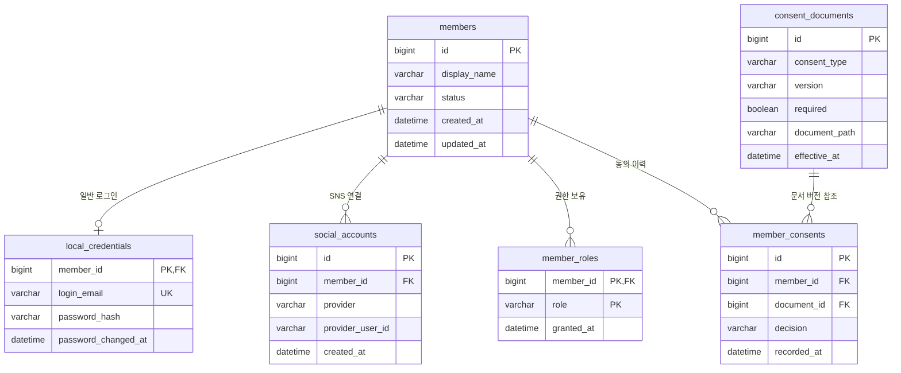
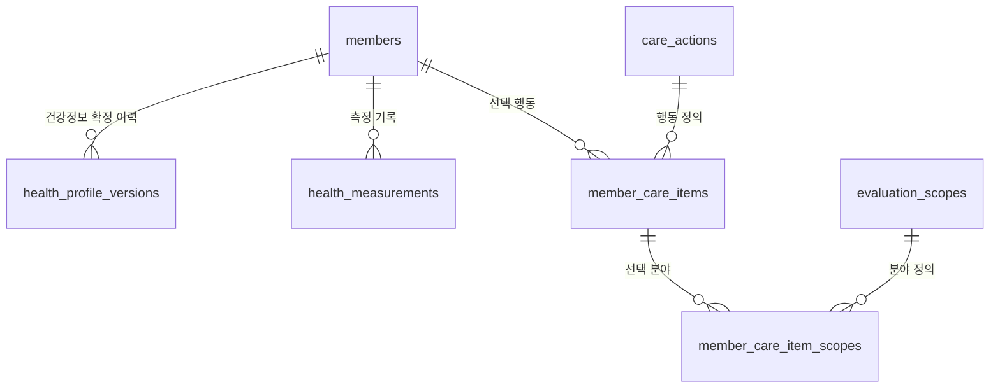

# SmartNF 회원·인증 ERD 설계서

> 최신 상태(2026-10-28): 일반·카카오·네이버·구글 인증의 로컬 정상 동작을 사용자 확인했다. 아래 최초 설계의 미확정/미구현 표는 당시 기록이며 현재 상태와 구분한다. 건강정보 물리 저장·실제 MyPage는 구현 전이며 신규 검토·필드 매핑·테이블/API 제안은 `SmartNF_HEALTH_STORAGE_PLAN.md`를 따른다. 실제 DB 최신 이력·운영 배포는 별도 확인 대상이다.

- 작성일: 2026-10-28
- 상태: 1차 설계안. DB 생성·마이그레이션·Java 구현 전 검토본
- 범위: 회원가입·로그인·SNS 인증·사용자/관리자 권한·동의 이력과 헬스케어 연결

## 1. 개발 방향 — 사용자 확정

SmartNF 하나의 프로젝트 안에서 지금처럼 통합 개발한다. 로그인 서버나 별도 회원 프로젝트를 만들지 않는다. 로그인·회원가입은 헬스케어, AI 레시피·식단, MyPage 등에서 같은 회원 계정을 사용한다.

나중에 헬스케어를 세미프로젝트로 추출할 때 헬스케어 화면과 필요한 로그인·회원가입·건강 기록용 MyPage·Java 코드·DB·정적 자료·설정을 함께 포함한다. 화면만 복사하면 독립 실행되는 구조라는 뜻은 아니다. 다른 서비스 전용 화면·코드·데이터는 의존성을 확인하고 제외한다.

현재 설계는 공통 회원과 서비스 데이터를 연결해 향후 추출 범위를 명확하게 만드는 목적이다. 프로젝트를 지금 나누지 않는다.

## 2. 근거와 현재 상태

| 구분 | 확인된 내용 |
|---|---|
| 사용자 실행 환경 | localhost:8080, bash run_local.sh 실행, MySQL smartnf 연결 성공 |
| 현재 테이블 | 사용자 확인: flyway_schema_history 하나. 회원·건강기록 테이블 없음 |
| 현재 코드 | SecurityConfig의 폼 로그인·관리자 권한 경로·CSRF 보호 존재. 로그인은 개발용 계정, 가입은 화면 시연 |
| 의존성 | 제공 build.gradle에 Security·JPA·MySQL·Flyway·Validation 포함 |
| 기존 설계 | 제공 docs ZIP 및 src ZIP에서 회원 ERD·테이블 정의·생성 SQL을 찾지 못함. 다른 자료의 존재 여부는 미확인 |
| 최신 작업 | 사용자 PC에서 관리항목 선택·해제·확정·페이지 전달·복원 정상 확인 |
| 저장 상태 | 건강정보·관리항목·식품 선택은 브라우저 같은 탭 임시 보관 중심. 회원 저장 아님 |

본 문서의 테이블명·컬럼·제약·인증 정책은 아래에 명시한 설계 제안이다. 기존 설계에서 확인한 이름으로 간주하지 않는다. 자료 근거는 docs/SmartNF_IMPROVEMENTS.md 49~51·64·70·89절, docs/FOOD_REGISTRATION_CONTRACT.md, 제공 SecurityConfig.java·로그인/가입 템플릿 및 사용자 확인 내용이다.

## 3. 설계 원칙

1. 서비스 데이터는 이메일 대신 내부 회원 ID를 참조한다.
2. 회원 본체와 로그인 수단을 구분한다. 일반 로그인만, SNS 로그인만, 둘 다 연결한 회원을 표현한다.
3. SNS 이메일이 같다는 이유로 자동 병합하지 않는다. 제공자 회원 ID가 SNS 계정 식별 기준이다.
4. 일반 회원가입에서는 USER만 부여한다. ADMIN은 서버의 통제된 운영 절차로 부여한다.
5. 가입 동의와 건강정보 저장 동의를 구분한다. 민감정보 동의가 필요하다는 이유로 계정 생성 자체에 건강정보 입력을 강제하지 않는다.
6. 기존 CSRF·세션 보호·관리자 경로 제한을 유지한다. 관리자 체험은 가상 자료의 읽기 전용으로 유지한다.
7. 가상 예시·브라우저 임시 데이터를 로그인만으로 실제 회원 기록에 자동 저장하지 않는다. 명시적 저장과 소유권 검증을 거친다.

## 4. 회원·인증 ERD

ERD 이름은 실제 구현 후보인 소문자 테이블명이다. Mermaid를 지원하는 Markdown 뷰어에서 관계도로 표시된다.

members와 인증 수단의 관계는 각각 선택적이다. 다만 계정 생성 완료 시에는 최소 하나의 인증 수단과 USER 권한이 존재해야 한다. 이 다중 테이블 조건은 단순 외래키만으로 강제할 수 없으므로 생성 트랜잭션과 서비스 검증으로 보장한다. 마지막 로그인 수단 제거는 차단하거나 별도 탈퇴 절차로 처리한다.

## 5. 테이블 정의 — 제안

공통: MySQL을 대상으로 BIGINT 양수 ID, DATETIME(6), 문자열은 utf8mb4를 제안한다. ID의 Java 매핑과 맞추기 위해 BIGINT는 signed로 둔다. 생성형 ID의 AUTO_INCREMENT 사용 여부는 아래 표에 명시한다. 물리 SQL은 실제 MySQL 버전·기존 Flyway 상태 확인 후 확정한다. 시간은 UTC로 보관하고 사용자 표시·식사 날짜 경계는 Asia/Seoul로 변환한다.

### 5.1 members

| 컬럼 | 제안 자료형 | 필수 | 키·설명 |
|---|---|---|---|
| id | BIGINT | 예 | PK, AUTO_INCREMENT |
| display_name | VARCHAR(50) | 예 | 표시 이름. 중복 허용 제안, 실명 아님 |
| status | VARCHAR(20) | 예 | ACTIVE / SUSPENDED / WITHDRAWN |
| created_at | DATETIME(6) | 예 | 가입 시각 |
| updated_at | DATETIME(6) | 예 | 회원 기본정보 최종 변경 |

회원 테이블에 건강 수치·질환·관리목표를 넣지 않는다. 상태 변경 시 기존 세션을 어떻게 만료시킬지 구현 단계에서 검증한다. WITHDRAWN만 표시하는 것으로 개인정보 삭제가 완료됐다고 간주하지 않는다.

### 5.2 local_credentials

| 컬럼 | 제안 자료형 | 필수 | 키·설명 |
|---|---|---|---|
| member_id | BIGINT | 예 | PK 및 FK → members.id. 회원당 최대 1개 |
| login_email | VARCHAR(254) | 예 | 정규화된 로그인 이메일, UNIQUE |
| password_hash | VARCHAR(255) | 예 | 비밀번호 해시. 원문 저장 금지 |
| password_changed_at | DATETIME(6) | 예 | 비밀번호 설정·변경 시각 |

이메일 정책 제안: 앞뒤 공백 제거 후 Locale.ROOT 소문자화한 값을 식별자로 사용하며, 이 서비스의 대소문자 구분 없는 로그인 정책임을 명시한다. 점 제거·플러스 주소 제거·제공자별 별칭 병합은 하지 않는다. 허용 이메일 형식은 입력 검증과 함께 확정한다. DB 정렬 규칙도 이 정책과 일치시켜 서로 다른 이메일이 의도 없이 같은 것으로 처리되지 않도록 한다.

이메일 소유 확인은 아직 구현 범위 미확정이다. 미인증 이메일을 검증된 본인 이메일로 표시하지 않는다. 비밀번호는 Spring Security PasswordEncoder로 처리하며 알고리즘·입력 길이·작업 비용은 구현 전에 확정한다.

### 5.3 social_accounts

| 컬럼 | 제안 자료형 | 필수 | 키·설명 |
|---|---|---|---|
| id | BIGINT | 예 | PK, AUTO_INCREMENT |
| member_id | BIGINT | 예 | FK → members.id, 조회 인덱스 |
| provider | VARCHAR(30) | 예 | 제공자 코드. 지원 제공자 미확정 |
| provider_user_id | VARCHAR(255) | 예 | 제공자가 인증한 고유 ID |
| created_at | DATETIME(6) | 예 | 연결 시각 |

UNIQUE(provider, provider_user_id)를 적용한다. 제공자 ID는 원문 대소문자를 보존하고 이진 비교를 사용한다. 한 회원에 같은 제공자의 여러 계정을 허용할지는 미확정이며, 금지하기로 하면 UNIQUE(member_id, provider)를 추가한다.

SNS 이메일·이름만으로 회원을 찾거나 권한을 부여하지 않는다. 외부 계정 연결은 기존 회원 재인증과 SNS 인증을 거친 명시적 흐름으로 처리한다. 로그인 목적만으로 OAuth 액세스/리프레시 토큰을 장기 저장하는 컬럼은 이번 설계에 넣지 않는다.

### 5.4 member_roles

| 컬럼 | 제안 자료형 | 필수 | 키·설명 |
|---|---|---|---|
| member_id | BIGINT | 예 | FK → members.id, 복합 PK |
| role | VARCHAR(20) | 예 | USER / ADMIN, 복합 PK |
| granted_at | DATETIME(6) | 예 | 부여 시각 |

DB 값 USER·ADMIN을 Spring Security의 ROLE_USER·ROLE_ADMIN 권한으로 매핑한다. 최초 관리자는 통제된 별도 절차로 지정하며 구체 방식은 미확정이다. 가입 폼의 role 값은 신뢰하지 않는다.

### 5.5 consent_documents

| 컬럼 | 제안 자료형 | 필수 | 키·설명 |
|---|---|---|---|
| id | BIGINT | 예 | PK, AUTO_INCREMENT |
| consent_type | VARCHAR(40) | 예 | TERMS / PRIVACY / HEALTH_DATA 등 후보 |
| version | VARCHAR(30) | 예 | 문서 버전 |
| required | BOOLEAN | 예 | 해당 동의 절차의 필수 여부. 모든 기능의 전역 필수 의미 아님 |
| document_path | VARCHAR(500) | 예 | 변경 없이 보존할 해당 버전 문서 경로 |
| effective_at | DATETIME(6) | 예 | 효력 시작 시각 |

UNIQUE(consent_type, version). 이미 동의 이력에서 참조한 문서의 내용·경로·의미를 조용히 덮어쓰지 않는다. 개정은 새 버전으로 추가한다. 실제 문구와 건강정보 처리 목적·범위·보관 정책은 별도 확정이 필요하다.

### 5.6 member_consents

| 컬럼 | 제안 자료형 | 필수 | 키·설명 |
|---|---|---|---|
| id | BIGINT | 예 | PK, AUTO_INCREMENT |
| member_id | BIGINT | 예 | FK → members.id |
| document_id | BIGINT | 예 | FK → consent_documents.id |
| decision | VARCHAR(20) | 예 | AGREED / WITHDRAWN |
| recorded_at | DATETIME(6) | 예 | 동의·철회 시각 |

동의·철회를 행 추가로 기록한다. INDEX(member_id, document_id, recorded_at, id)를 제안한다. 회원·문서별 마지막 이벤트를 recorded_at 및 id로 판별하되 서비스에서 동시 변경을 직렬화해 순서를 보장한다. 새 문서 버전이 생겼다고 이전 동의를 새 버전 동의로 간주하지 않는다. 전체 consent_type의 현재 유효성은 적용 문서 버전과 재동의 정책을 함께 확인한다.

### 5.7 외래키와 트랜잭션

- 외래키 삭제는 우선 RESTRICT로 설계하고 무차별 ON DELETE CASCADE는 사용하지 않는다. 탈퇴 정책 확정 후 인증정보·건강기록·동의 이력별 삭제/익명화/보관을 명시한다.
- 가입 시 members → 인증 수단 → USER 권한 → 필요한 동의 이력을 한 트랜잭션으로 저장한다. 실패 시 일부 회원만 남기지 않는다.
- 이메일/SNS 중복 사전 확인은 화면 편의를 위한 것이며 최종 중복 방지는 DB UNIQUE 제약과 충돌 처리로 보장한다.
- 건강정보 저장 요청의 member_id는 요청값을 신뢰하지 않고 인증 주체에서 결정한다.

## 6. 인증 흐름

### 일반 가입·로그인

이메일·비밀번호·확인값·표시 이름·필요 동의를 검증한 뒤 회원을 생성한다. DB에 저장한 해시로 로그인한다. 비밀번호 확인값은 저장하지 않는다. 오류 처리에서 비밀번호·토큰을 기록하지 않는다. 로그인 실패 안내는 계정 존재를 직접 확정하지 않는 공통 문구를 사용한다.

세션 기반 폼 로그인을 이어 사용하며 로그아웃은 CSRF를 포함한 POST로 처리한다. 기존 공개 헬스케어 조회와 읽기 전용 관리자 체험 정책을 유지하고 실제 개인 저장·관리 기능은 인증·권한을 검사한다.

### SNS 로그인

지원 제공자 설정 → 제공자 인증 → provider와 provider_user_id 검증 → 연결된 회원 조회 또는 명시적 신규 가입·동의 → 권한 부여 순서다. 제공자 미설정 시 동작하는 로그인처럼 표시하지 않는다. 신규 OAuth 의존성·제공자 설정·콜백 URL은 구현 단계에서 확정한다.

## 7. 헬스케어 연결 ERD — 개념 설계

아래는 전체 헬스케어 물리 ERD가 아니라 회원 연결과 이력의 경계를 정한 개념 설계다. 상세 테이블·컬럼·영양 DB·식사 기록은 별도 정의가 필요하다.

| 개념 | 관계·역할 | 상세 설계 시 필요한 내용 |
|---|---|---|
| health_profile_versions | 회원의 확정 건강정보를 버전으로 보관 | 현재 버전 지정, 측정기록과 중복 방지, 질환·목표·제한 조건의 구조화 |
| health_measurements | 측정/검사 시점별 값 | 지표 코드·단위·측정일·공복/식후·혈압 환경·기관·출처·품질 상태 |
| care_actions | 공통 실천 행동 정의 | 기존 행동 10개 ID와 호환, 설명·근거 버전 |
| evaluation_scopes | BMI·혈압·혈당·지질·식습관·활동 분야 | 기존 프론트 분야 코드와 대응 |
| member_care_items | 회원이 선택한 행동 | 같은 활성 행동 중복 방지, 선택/중단 시각, 선택 당시 건강정보·근거 버전 |
| member_care_item_scopes | 행동에 직접 연결한 분야 | 같은 행동의 다분야 연결, 일부 분야 해제와 전체 행동 중단 구분 |

활성 행동의 중복 방지와 중단·재등록 이력의 동시 보존은 별도 물리 설계가 필요하다. 단순 UNIQUE(member_id, action_id)만 넣고 재등록 이력이 모두 해결됐다고 간주하지 않는다.

후속 테이블: 구조화 알레르기·제한 조건, 선택/확정 식품, 실천 기록, 식단 계획, 실제 섭취, 평가·추천 결과와 근거 버전. 기존 sessionStorage JSON을 그대로 전체 도메인 테이블 정의로 사용하지 않는다. 미입력·미확인·본인 확인 없음, 계획·선택·실제 섭취를 구분한다.

## 8. 헬스케어 세미프로젝트 추출 범위

| 포함 | 제외 후보 |
|---|---|
| 로그인·회원가입·SNS 설정·권한·필요 동의 | 다른 서비스 전용 인증 후 이동/메뉴 |
| 헬스케어 4개 페이지·관련 처리 코드·자료 | AI 레시피·식단 전용 생성·최적화 기능 |
| 건강 기록에 필요한 MyPage | 구매·주문·문서 자동화·커뮤니티 전용 기능 |
| 관련 DB 테이블·마이그레이션·공통 헤더/푸터·설정 | 해당 서비스만 사용하는 테이블·키·데이터 |

추출 시 메뉴·링크·API·테이블 외래키·데이터·환경변수·마이그레이션 의존성을 함께 확인한다. 원본의 기존 Flyway 이력을 임의 편집하지 않고 추출본의 신규 설치·실행 검증 방법을 별도로 결정한다. 현재는 이 작업을 수행하지 않는다.

## 9. 미확정 사항

| 항목 | 상태 |
|---|---|
| SNS 제공자 | 미확정. 카카오 우선은 제안만 됨 |
| 이메일 인증·비밀번호 재설정 | 1차 포함 여부 미확정. 필요하면 만료·일회성·해시 토큰의 별도 테이블 설계 |
| 표시 이름 | 필수·중복 허용을 제안. 사용자 확정 전 |
| 관리자 최초 지정·권한 변경 감사 | 운영 방식 미확정 |
| 탈퇴·건강정보 동의 철회 | 삭제/보관·재가입·세션 종료·SNS 연결 해제 정책 미확정 |
| 건강정보 세부 물리 ERD | 개념 관계만 제안. 전체 컬럼·제약·데이터 마이그레이션은 후속 |
| 실제 MySQL 버전·서버 설정 | 제공 자료만으로 확인되지 않음 |

## 10. 구현 순서와 완료 기준

1. 미확정 정책과 회원 물리 설계 검토.
2. Flyway 초기 회원 스키마 작성. 기존 이력·MySQL 버전 확인 후 적용.
3. 회원가입·DB 인증·로그아웃·권한과 동의 처리 구현.
4. SNS 제공자 설정과 실제 인증 검증.
5. 회원별 헬스케어 저장·MyPage 기록의 상세 ERD와 API 구현.
6. 세미프로젝트 추출 가능성 및 전체 연동 검증.

검증 항목: 중복 가입 경합·트랜잭션 롤백·해시 로그인·정지 회원 차단·CSRF·관리자 권한 상승 차단·SNS 계정 오연결 방지·다른 회원 데이터 차단·동의 버전·로그아웃/계정 전환 시 브라우저 임시 상태 혼입 방지. 설계서 작성만으로 이 검증을 완료 처리하지 않는다.

이번 산출물은 설계 문서와 개선사항 기록뿐이다. 실행 중인 서버·DB·Java·HTML·CSS·JS·설정은 변경하지 않았다.

## 11. 1차 구현 현황 — 2026-10-28

일반 가입·DB 로그인·로그아웃·권한·6개 테이블의 구현본을 작성했다. 실제 적용/검증 완료가 아니라 로컬 실행 확인 대기다. 회원 Repository는 기존 JPA 설정을 유지하며 JdbcTemplate으로 명시 SQL/트랜잭션을 구현했다.

표시이름 필수·중복허용, 이메일 소문자화, 비밀번호 길이 제한을 개발 검증용 기본값으로 적용했다. 약관은 운영용으로 확정하지 않고 별도 dev-20261028 안내 문서만 연결했다. SNS는 테이블만 준비했으며 제공자 인증·계정연결 API는 미구현이다. 탈퇴/보관·이메일 인증·재설정·최초 관리자·건강정보 DB 저장은 미완료다.

이번 변경은 과거 설계 항목을 구현한 범위만 갱신한다. 세부 적용·검사 한계는 MEMBER_AUTH_IMPLEMENTATION.md와 개선문서 91절을 따른다.

## 12. 카카오 연결 구현 현황 — 2026-10-28

일반 회원 기능의 사용자 로컬 테스트·V1·가입/로그인/로그아웃 정상 확인 이후 카카오1차 구현본을 추가했다. social_accounts의 기존 provider+provider_user_id UNIQUE를 사용하고 신규 카카오 회원은 local_credentials를 만들지 않는다. 최초 인증과 SmartNF가입동의는 분리하고가입대기10분 동안실회원권한을주지않는다. 이메일자동병합/기존회원계정연결은후속이다.

기존 dev-20261028 동의문서는유지하고 V2로 dev-kakao-20261028 문서2개를추가한다. 네이버/구글제공자등록은아직없다. 버튼은서버준비플래그·키·고정공개주소·접속주소일치시에만표시한다. 자세한설정/검증한계는 KAKAO_LOGIN_SETUP.md및개선문서94절참고. 실제카카오인증·V2적용·Java테스트는확인대기다.

## 13. 네이버 연결 및 카카오 확인 현황 — 2026-10-28

카카오가입·로그인·로그아웃·기존회원재로그인은사용자확인완료. 이후네이버1차구현을추가했으며 provider=naver + opaque문자열ID로회원연결한다. 기존6개회원테이블과provider/ID유일성규칙을재사용하고추가회원테이블은없다.

V3는dev-naver-20261028 동의문서2개만추가하며V1/V2와기존동의는유지. 기존계정자동병합은없고신규SNS계정의SmartNF가입동의를별도로확인한다. 제공자준비조건에따라카카오/네이버버튼을각각표시하고Google은미등록이다. 네이버실제인증·V3·Java테스트와이번공통변경후카카오회귀는확인대기다. 상세는 NAVER_LOGIN_SETUP.md 및 개선문서96절을참조한다.

## 14. 구글 OpenID Connect 구현 반영 (2026-10-28)

회원 인증은 동일 SmartNF 프로젝트에서 공통 기능으로 유지한다. 테이블/관계를 추가하지 않고 social_accounts.provider=google, provider_user_id=검증된 sub로 식별한다. provider+ID의 기존 고유 제약으로 다른 제공자와 구분한다. 이메일 기준 자동 연결은 없다.
V4는 dev-google-20261028 TERMS/PRIVACY 개발 문서 두 행만 추가한다. 가입 시 members, social_accounts, member_roles(USER), member_consents를 트랜잭션으로 저장하며 local_credentials를 만들지 않는다. V1~V3 및 과거 동의는 변경하지 않는다.
가입 전 ID/검증 시각은 서버 세션 10분, 최종 인증 상태는 내부 member ID/표시 이름/권한을 사용한다. 구글 ID 토큰은 OIDC 로그인 세션에 포함되지만 토큰 DB 컬럼은 만들지 않는다. 액세스/리프레시 토큰은 최종 세션·DB에 저장하지 않는다. 건강정보 영구 저장과 MyPage 관련 ERD 구현은 후속이다.
구글 실제 인증/운영 승인 및 MySQL V4 적용은 사용자 확인 대기다. 카카오·네이버 로컬 동작은 사용자 정상 보고를 받았다.

## 15. 회원별 건강정보 저장·MyPage 1차 구현본 (2026-10-28)

V5에 9개 건강 관련 테이블과 별도 HEALTH_DATA 개발 동의 문서를 추가했다. 상세 컬럼/관계는 V5__create_health_storage.sql, 입력87개 매핑은 HealthFields.java에 정의했다. 기존 회원/인증 스키마 V1~V4는 불변이다.

health_profile_versions는 프로필32개 입력의 형식별 컬럼과 member_id·request_id·body_hash·consent_document_id·consent_event_id·created_at을 갖는다. 질환 선택/상세36개 이름은 health_profile_conditions의 구조화 행으로, 측정19개는 health_measurements(metric_code,metric_value,unit_code)로 저장한다. 선택 응답은 schema_version=1의 V0/V1 등 고정 코드로 보관하며 API 복원 시 원래 양식 값으로 변환한다. 과거 버전 의미를 바꾸는 순서 변경은 금지한다.

관리항목은 care_actions/evaluation_scopes/care_action_scopes 마스터와 member_care_sets/member_care_items/member_care_item_scopes 확정 이력으로 구성한다. profile_id+member_id 복합 FK로 다른 회원의 프로필 연결을 차단한다. 이전 확정본 포인터 컬럼 없이 회원별 id 순서로 버전을 조회하고 members 행 잠금으로 저장 순서를 직렬화한다. 일부 분야 해제·전체 해제·재등록은 새 확정본이다.

단순 JSON 보관이 아니라 서버가 필드/타입/열/단위를 정한다. 회원 소유권은 세션 내부 ID를 사용하며 ADMIN도 본인 데이터로 제한한다. 건강정보/관리항목 원문·회원ID를 URL/탭 간 동의 신호에 담지 않는다. 철회는 자식부터 본인 건강 기록을 삭제하고 동의 이력·회원 계정을 유지하는 개발 기본안으로 구현했다. 운영용 보관/백업/탈퇴 정책 확정은 후속이다.

Java21 Spring 통합/JUnit·MySQL V5·실제 브라우저 동작은 아직 확인 전이다. 독립 Java 입력 검증, JS 계정/복원/API 모의 검사, SQLite 관계형 제약/삭제 모의 검사만 통과했다. 알레르기·식사·차트/AI는 미구현이다.
